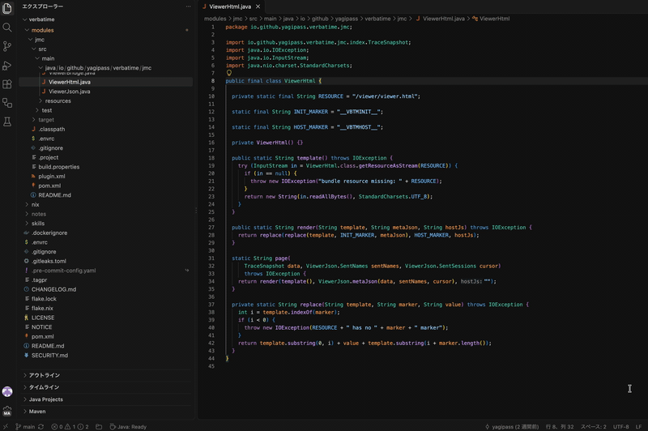

# Spotless for Gradle and Maven

[](https://marketplace.visualstudio.com/items?itemName=yagipass.vscode-spotless-for-gradle-and-maven)
[](https://open-vsx.org/extension/yagipass/vscode-spotless-for-gradle-and-maven)
[](https://github.com/yagipass/vscode-spotless-for-gradle-and-maven/actions/workflows/build.yml)
[](LICENSE)

Formats a file on save with the [Spotless](https://github.com/diffplug/spotless) configuration of its Gradle or Maven build.



It runs your build's own Spotless plugin on the unsaved buffer, so everything the build resolves applies, including build scripts, parent POMs, `pluginManagement`, profiles, `.mvn/maven.config` and formatter settings shipped in plugin dependencies.

## Gradle

### Requirements

- JDK 17 or later.
- Gradle 8.1 or later.
- The Spotless Gradle plugin 8.7.0 or later.
- The [Gradle for Java](https://marketplace.visualstudio.com/items?itemName=vscjava.vscode-gradle) extension 3.12.6 or later.

### Usage

To format on save, add this to your settings.

```json
"[java]": {
  "editor.codeActionsOnSave": { "source.fixAll.spotlessForGradleAndMaven": "explicit" },
  "editor.formatOnSave": false
}
```

Or run **Spotless: Format Document** from the Command Palette.

To also run another code action on save, such as `source.organizeImports`, list them in an array that ends with Spotless, as in `["source.organizeImports", "source.fixAll.spotlessForGradleAndMaven"]`. In an object, VS Code runs Spotless first, so the other action can leave a file that fails `spotlessCheck`.

## Maven

### Requirements

- JDK 17 or later.
- Maven 3.6.3 or a later 3.x.
- spotless-maven-plugin 2.40.0 or later. Older versions rewrite the module's files on disk.
- [mvnd](https://github.com/apache/maven-mvnd) 1.0.3 or a later 1.x is recommended. It takes about 0.3 s per save, against about 1 s with `mvn` or `mvnw`.

### Usage

To format on save, add this to your settings.

```json
"[java]": {
  "editor.codeActionsOnSave": { "source.fixAll.spotlessForGradleAndMaven": "explicit" },
  "editor.formatOnSave": false
}
```

Or run **Spotless: Format Document** from the Command Palette.

To also run another code action on save, such as `source.organizeImports`, list them in an array that ends with Spotless, as in `["source.organizeImports", "source.fixAll.spotlessForGradleAndMaven"]`. In an object, VS Code runs Spotless first, so the other action can leave a file that fails `spotless:check`.

### Settings

`spotlessForGradleAndMaven.maven.executable` sets the Maven executable. When it is empty, the extension uses `mvnd` on the `PATH`, then `mvnw` in the build root, then `mvn` on the `PATH`, so a build with `mvnw` still runs on mvnd if mvnd is installed.

## Troubleshooting

If a saved file is not formatted, open the Output panel and select **Spotless for Gradle and Maven**. A build that fails is logged there with its output. To also log files that no Spotless format targets and the output of every build, run **Developer: Set Log Level...**, select **Spotless for Gradle and Maven**, and choose **Debug**.

## Limitations

- In Maven builds with `ratchetFrom`, the first save after a change is not formatted. With mvnd, later saves may not be formatted either. Set `spotlessForGradleAndMaven.maven.executable` to `mvn` in that case.
- A file that more than one Spotless format targets is not formatted, and a warning is logged.
- Steps that use npm, such as prettier, take several seconds.
- In a build or Maven module without Spotless, only the first save runs a build. Saves there run one again after a `pom.xml`, `*.gradle` or `*.gradle.kts` file in the workspace changes, or after **Developer: Reload Window**.
- Formatting does not run when `files.autoSave` is `afterDelay`, because VS Code runs no code actions on auto save.
- In Gradle builds, a file whose path contains a comma is not formatted, and an error is logged, because the Spotless Gradle plugin reads the comma as a separator between files.
- In Maven builds, includes in a parent POM that reach into child module directories, such as `**/*.md` at the root, are not supported.
- In Maven builds, saving a file in a project that the topmost `pom.xml` in the workspace does not include as a module, such as a standalone sample or a module listed only in an inactive profile, runs Maven twice, the second time in that project's directory.
- On Windows, Maven builds fail when a path contains characters outside the system code page, such as Japanese on an English Windows. This includes the paths of the user profile and the temp folder.
- On Windows, mvnd runs its slower JVM client when a path contains non-ASCII characters, because its native client garbles them.

## Privacy

The extension sends no telemetry. To format a file, it writes the unsaved buffer to a new folder under the temp folder, runs your build on it locally, and deletes the folder when the build ends or VS Code quits. The folder is left behind only if VS Code crashes or the build does not stop within 5 seconds of quitting.

## Acknowledgements

Inspired by [Spotless Gradle](https://github.com/badsyntax/vscode-spotless-gradle) by Richard Willis and [Spotless Maven](https://github.com/SapiensAnatis/vscode-spotless-maven) by Jay Malhotra.
